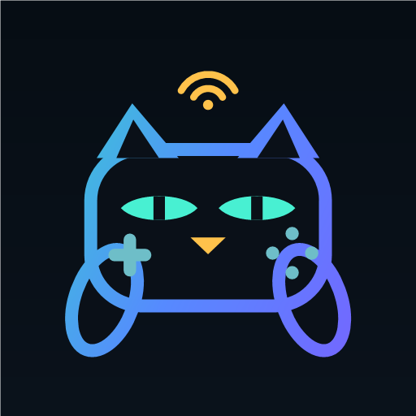

# SKZ Connect

**Use Switch 2 controllers and many others on Windows as Xbox or DualShock 4 controllers –
in games, Steam and emulators.**

Also available: SKZ Connect for Android (beta) and an add-on for Kodi/LibreELEC.

[Deutsch](README.md) · **English** · [Website](https://devcatskz.github.io/SKZ-Connect/)

## Download

| Platform | Version | Download | Guide |
|---|---|---|---|
| Windows 10 (2004 or later) and 11, 64-bit | 1.0.24 | [Setup or portable ZIP](https://github.com/DevCatSKZ/SKZ-Connect/releases/latest) | [Windows](docs/guide/windows.md) |
| Android 8 or later | 0.9.3 beta | [SKZ-Connect-Android-0.9.3.apk](https://github.com/DevCatSKZ/SKZ-Connect/releases/download/v1.0.24/SKZ-Connect-Android-0.9.3.apk) | [Android](docs/guide/android.md) |
| Kodi on LibreELEC | 0.4.8 | [DevCatSKZ Repository](https://github.com/DevCatSKZ/kodi-repo) | [Kodi](docs/guide/kodi.md) |

The Windows setup installs the required drivers ViGEmBus and HidHide. Setup and app are not code-signed, so Windows
SmartScreen shows a warning on first launch.

## Supported controllers

| Controller | Windows | Android | Kodi |
|---|---|---|---|
| Pro Controller 2, Joy-Con 2 | ✓ | ✓ | ✓ |
| GameCube controller (Switch 2) | ✓ | ✓¹ | ✓¹ |
| Switch Pro Controller, Joy-Con (Switch), NSO controllers | ✓ | – | Pairing¹ |
| Wii Remote, Wii U Pro Controller | ✓ | – | Pairing¹ |
| DualShock 4, DualSense | ✓¹ | – | Pairing¹ |
| Xbox controllers | native² | – | Pairing¹ |
| Wired controllers by HORI, PowerA, PDP | ✓¹ | – | – |

¹ Not yet tested with real hardware – [feedback](https://github.com/DevCatSKZ/SKZ-Connect/issues) is welcome.
² Windows supports Xbox controllers natively; SKZ Connect adds battery display and remapping.
**Pairing:** SKZ Connect pairs the controller, Linux handles the input. On Android, other controllers connect directly
to the system.

## Features

**Windows**
- Output as Xbox 360 or DualShock 4 (with motion data for Steam), globally or per controller
- Up to 8 controllers, Joy-Con individually or as a pair
- Remapping with keyboard, mouse, turbo and macros; profiles switch automatically per game
- Gyro as stick or mouse, flick stick, DSU server for emulators
- amiibo, Ring-Con, IR camera, stick calibration, low-battery warning
- Original devices are hidden from games via HidHide – no duplicate controllers

**Android (beta):** Switch 2 controllers as a virtual Xbox controller via Shizuku or root, with rumble, gyro,
per-game profiles and DSU; plus touch controls for games without controller support.

**Kodi/LibreELEC:** Switch 2 controllers as Xbox controllers for Kodi and RetroArch, with Joy-Con pairs, rumble,
fixed player slots, DSU and a home screen widget.

## Status

Windows is the main platform. Android is in beta. The Kodi add-on is tested on a Raspberry Pi 4 with LibreELEC 12.2,
other devices are not tested yet. The ViGEmBus driver is no longer developed since 2023; SKZ Connect uses its final
version 1.22.0.

## Privacy

No account, no telemetry, no ads. Controllers work without internet; the Windows app checks GitHub for updates at
startup (can be turned off).

## Documentation

- Guides: [Windows](docs/guide/windows.md) · [Android](docs/guide/android.md) · [Kodi](docs/guide/kodi.md) ·
  [Troubleshooting](docs/guide/troubleshooting.md)
- [Technical documentation](docs/README.md) (German)
- Please report bugs as an [issue](https://github.com/DevCatSKZ/SKZ-Connect/issues), ideally with a diagnostics file
  (Windows: *General › Advanced › Export diagnostics*).

## Building

.NET 10 SDK on Windows: `dotnet test Switch2Pro.sln -c Release`. Setup, Android app and Kodi add-ons are described
in [HANDOVER.md](HANDOVER.md#bauen-und-testen) (German).

## License

[MIT](LICENSE), © 2026 devcatskz. Third-party components: [THIRD-PARTY-NOTICES.md](THIRD-PARTY-NOTICES.md).

Unofficial project, not affiliated with Nintendo, Sony or Microsoft. All trademarks belong to their respective owners.
