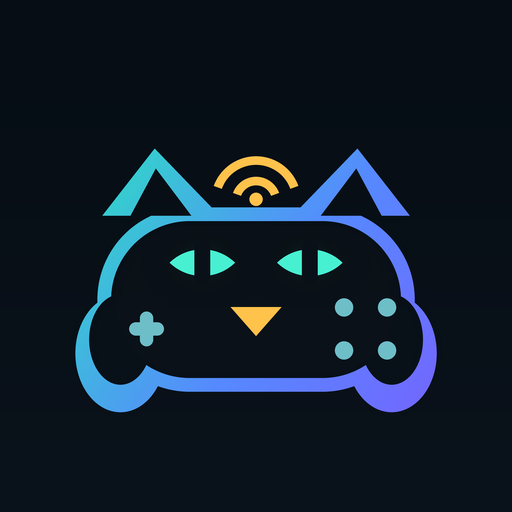

# N-Connect

**Switch-2-Controller und weitere Controller unter Windows als Xbox- oder DualShock-4-Controller –
für Spiele, Steam und Emulatoren.**

Dazu N-Connect für Android (Beta) und ein Add-on für Kodi/LibreELEC.

**Deutsch** · [English](README.en.md) · [Webseite](https://devcatskz.github.io/N-Connect/)

## Download

| Plattform | Version | Download | Anleitung |
|---|---|---|---|
| Windows 10 (ab 2004) und 11, 64 Bit | 1.0.22 | [Setup oder Portable-ZIP](https://github.com/DevCatSKZ/N-Connect/releases/latest) | [Windows](docs/anleitung/windows.md) |
| Android 8 oder neuer | 0.9.1 Beta | [N-Connect-Android-0.9.1.apk](https://github.com/DevCatSKZ/N-Connect/releases/download/v1.0.22/N-Connect-Android-0.9.1.apk) | [Android](docs/anleitung/android.md) |
| Kodi unter LibreELEC | 0.4.4 | [DevCatSKZ Repository](https://github.com/DevCatSKZ/kodi-repo) | [Kodi](docs/anleitung/kodi.md) |

Das Windows-Setup installiert die benötigten Treiber ViGEmBus und HidHide mit. Setup und Programm sind nicht
code-signiert, daher zeigt Windows SmartScreen beim ersten Start eine Warnung.

## Unterstützte Controller

| Controller | Windows | Android | Kodi |
|---|---|---|---|
| Pro Controller 2, Joy-Con 2 | ✓ | ✓ | ✓ |
| GameCube-Controller (Switch 2) | ✓ | ✓¹ | ✓¹ |
| Switch Pro Controller, Joy-Con (Switch), NSO-Controller | ✓ | – | Kopplung¹ |
| Wii-Fernbedienung, Wii U Pro Controller | ✓ | – | Kopplung¹ |
| DualShock 4, DualSense | ✓¹ | – | Kopplung¹ |
| Xbox-Controller | nativ² | – | Kopplung¹ |
| Kabel-Controller von HORI, PowerA, PDP | ✓¹ | – | – |

¹ Noch nicht mit echter Hardware geprüft – [Rückmeldungen](https://github.com/DevCatSKZ/N-Connect/issues) helfen.
² Windows erkennt Xbox-Controller selbst; N-Connect ergänzt Akkuanzeige und Belegungen.
**Kopplung:** N-Connect koppelt den Controller, die Eingaben übernimmt Linux. Unter Android verbinden sich andere
Controller direkt mit dem System.

## Funktionen

**Windows**
- Ausgabe als Xbox 360 oder DualShock 4 (mit Bewegungsdaten für Steam), allgemein oder je Controller
- Bis zu 8 Controller, Joy-Con einzeln oder als Paar
- Tastenbelegung mit Tastatur, Maus, Turbo und Makros; Profile wechseln automatisch je Spiel
- Gyro als Stick oder Maus, Flick-Stick, DSU-Server für Emulatoren
- amiibo, Ring-Con, IR-Kamera, Stick-Kalibrierung, Akkuwarnung
- Originale werden per HidHide vor Spielen versteckt – keine doppelten Controller

**Android (Beta):** Switch-2-Controller als virtueller Xbox-Controller über Shizuku oder Root, mit Vibration,
Gyro, Profilen je Spiel und DSU; für Spiele ohne Controller-Unterstützung eine Touch-Steuerung.

**Kodi/LibreELEC:** Switch-2-Controller als Xbox-Controller für Kodi und RetroArch, mit Joy-Con-Paar, Vibration,
festen Spielerplätzen, DSU und Home-Widget.

## Stand

Windows ist die Hauptplattform. Android ist eine Beta. Das Kodi-Add-on ist auf einem Raspberry Pi 4 mit
LibreELEC 12.2 geprüft, andere Geräte noch nicht. Der Treiber ViGEmBus wird seit 2023 nicht mehr weiterentwickelt;
N-Connect nutzt die letzte Version 1.22.0.

## Datenschutz

Kein Konto, keine Telemetrie, keine Werbung. Die Controller funktionieren ohne Internet; die Windows-App sucht beim
Start auf GitHub nach Updates (abschaltbar).

## Dokumentation

- Anleitungen: [Windows](docs/anleitung/windows.md) · [Android](docs/anleitung/android.md) ·
  [Kodi](docs/anleitung/kodi.md) · [Hilfe bei Problemen](docs/anleitung/hilfe.md)
- [Technische Dokumentation](docs/README.md)
- Fehler bitte als [Issue](https://github.com/DevCatSKZ/N-Connect/issues) melden, möglichst mit Diagnose
  (Windows: *Allgemein › Erweitert › Diagnose exportieren*).

## Selbst bauen

.NET 10 SDK unter Windows: `dotnet test Switch2Pro.sln -c Release`. Details zu Setup, Android-App und Kodi-Add-ons
in [HANDOVER.md](HANDOVER.md#bauen-und-testen).

## Lizenz

[MIT](LICENSE), © 2026 devcatskz. Komponenten Dritter: [THIRD-PARTY-NOTICES.md](THIRD-PARTY-NOTICES.md).

Inoffizielles Projekt ohne Verbindung zu Nintendo, Sony oder Microsoft. Alle genannten Marken gehören ihren
jeweiligen Inhabern.
